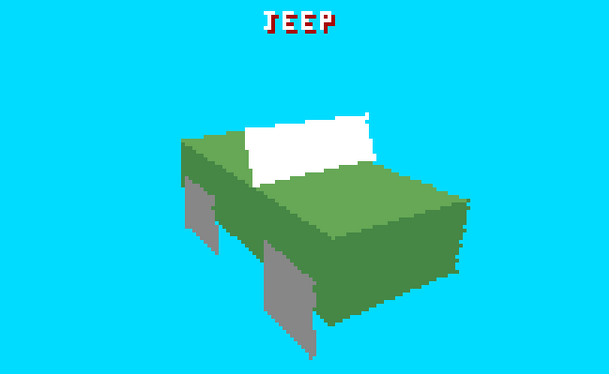

# Steel Talons model viewer

Atari Lynx program (C++, llvm-mos) that shows every Steel Talons 3D model full
screen with its name. Based on a copy of `lynx_llvm_basecode_public`.

Controls: LEFT/RIGHT previous/next model, UP/DOWN tilt the camera, A toggles the spin.



## Build

```bash
python3 tools/build.py        # -> out/TalonsViewer.lnx
```

Run `python3 setup.py` once first: it fetches the submodules and builds the
toolchain.

The models, the mission 1 palette and the game's font are in
`src/game/models_data.h/.cpp`, already converted.
